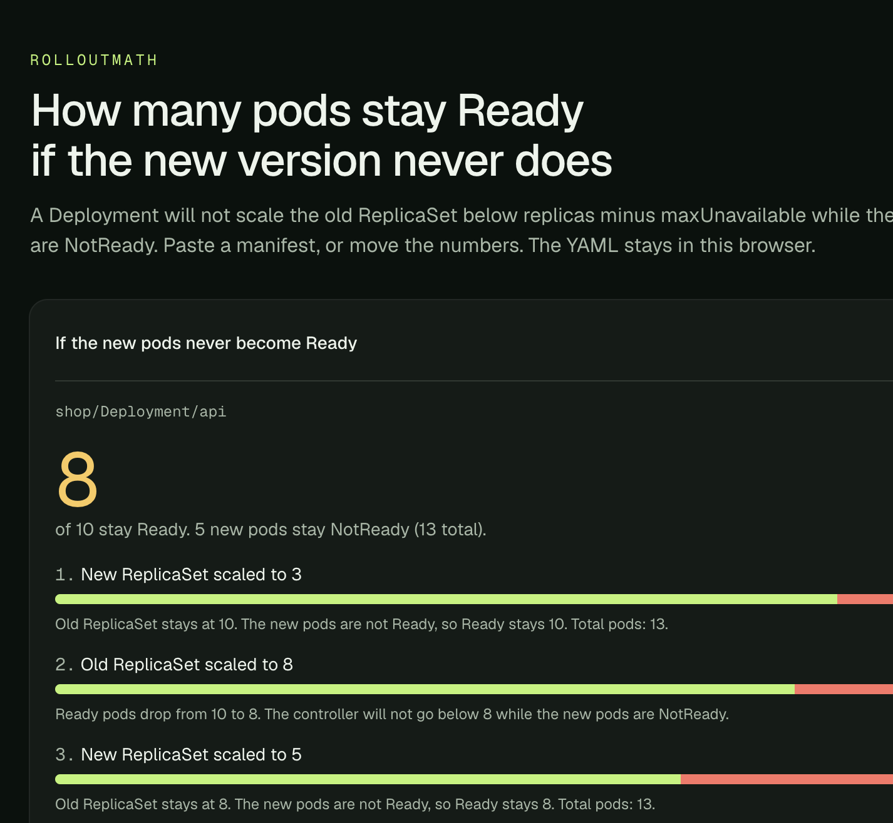
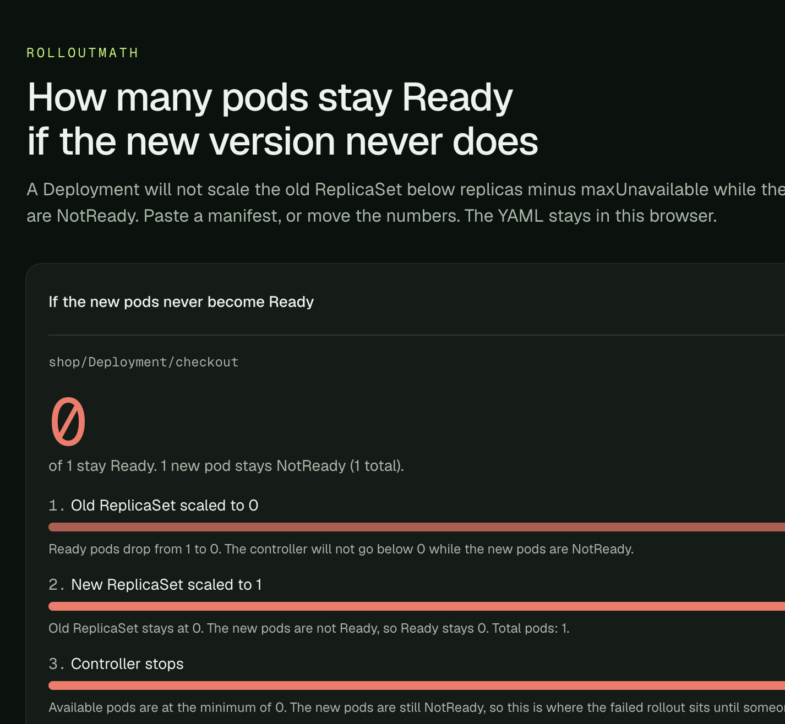
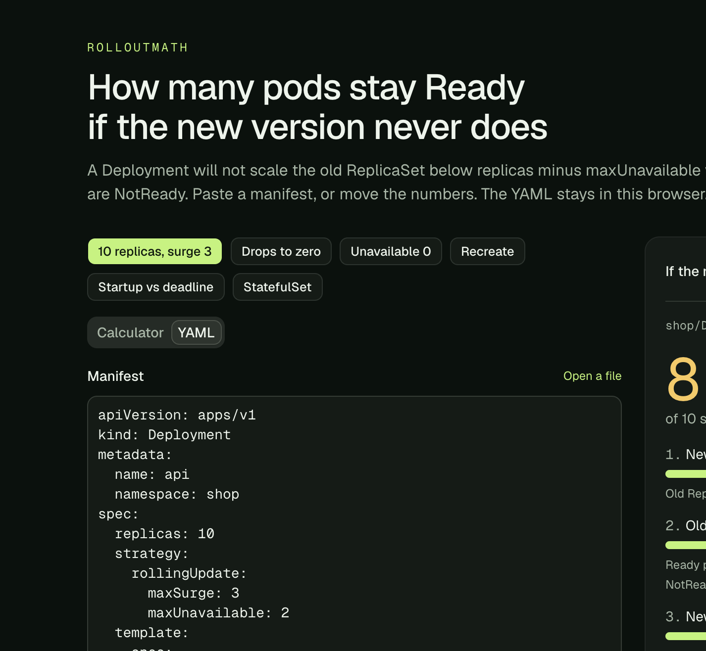
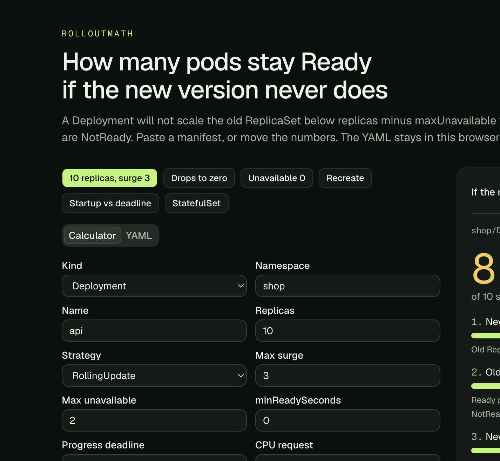
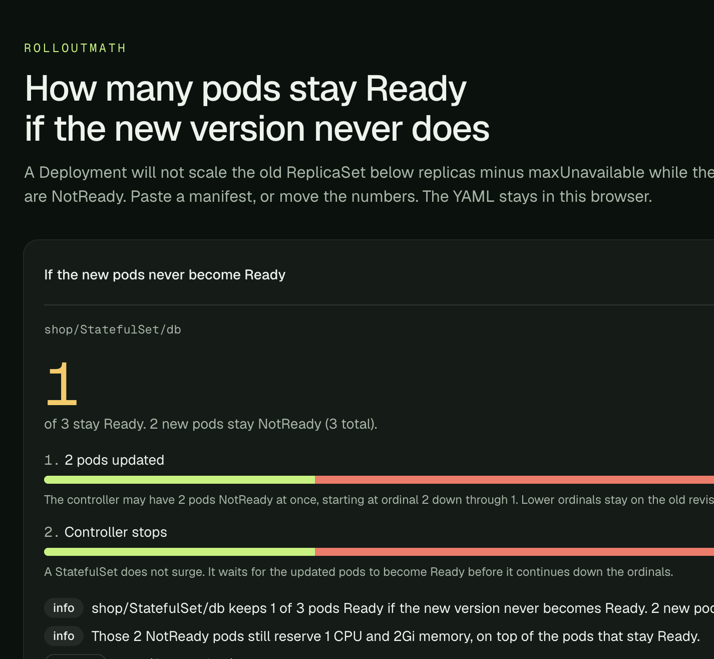

# rolloutmath

How many Kubernetes pods stay Ready if a rollout never becomes Ready.

Kubernetes will spend `maxUnavailable` before the new pods pass readiness. If the new image crashloops, fails probes, or never pulls, the old ReplicaSet is left at `replicas - maxUnavailable` and stays there. Kubernetes does **not** roll back on its own. A PodDisruptionBudget does not stop that loop either: it limits drains and evictions, not a Deployment rolling update.

`rolloutmath` walks the same controller math and answers one question: **what is the Ready floor of a stalled rollout?** Use it as a CI check that fails when that floor is 0 (or below a floor you set), or open the page and move the numbers.



## The problem it solves

A common production trap looks harmless in YAML:

```yaml
replicas: 1
strategy:
  rollingUpdate:
    maxSurge: 0
    maxUnavailable: 1
```

If the new pod never becomes Ready, the controller scales the old ReplicaSet to 0 first. The service is down until someone notices and rolls back. The same trap appears with the API defaults on a single replica (`25%` of 1 rounds surge up to 1 and unavailable down to 0 is safe; an explicit `maxUnavailable: 1` next to `maxSurge: 1` is not).



`rolloutmath` makes that floor visible before the manifest lands in the cluster: Ready count, NotReady surge pods, reserved CPU/memory for those pods, and the sync-by-sync path the controller takes.

## What is in the repo

| Piece | Role |
| --- | --- |
| Browser workbench | Calculator + YAML paste, runs entirely client-side |
| CLI `rolloutmath check` | CI gate over files, stdin, or `kubectl` output |
| Shared library in `src/lib/` | One simulation path for page and CLI |

### Browser

- Presets for the documented Kubernetes example, a floor-zero Deployment, `maxUnavailable: 0`, Recreate, startup-vs-deadline, and StatefulSet
- Calculator fields for kind, replicas, surge/unavailable, probes, requests, partition, progress deadline
- YAML tab: paste or open a file; manifests never leave the browser
- Step timeline with Ready / NotReady bars
- Copy Markdown report





### CLI

```bash
npm install
node --import tsx src/cli.ts check fixtures/shop.yaml
kubectl get deploy -A -o yaml | node --import tsx src/cli.ts check -
node --import tsx src/cli.ts check deploy.yaml --floor 3 --format markdown --strict
```

After `npm install`, `npx rolloutmath check deploy.yaml` works the same way (`bin/rolloutmath.js`).

| Flag | Meaning |
| --- | --- |
| `--floor N` | Exit 2 if any workload's Ready floor is below `N` |
| `--format text\|json\|markdown` | Report shape (default `text`) |
| `--strict` | Treat warnings as failures |
| `-` | Read stdin |
| multiple files | Merge workloads; a Service-only file does not hide a Deployment in the next file |

Exit codes:

| Code | When |
| --- | --- |
| `0` | No errors (warnings alone are OK unless `--strict`) |
| `1` | Unreadable input, or no Deployment / StatefulSet found |
| `2` | Floor is 0, strategy invalid, deadline conflict, already `ProgressDeadlineExceeded`, `--floor` missed, or `--strict` warning |

Example CI gate:

```bash
node --import tsx src/cli.ts check fixtures/shop.yaml --floor 9
# exit 2 — shop/Deployment/api keeps 8 Ready, below the required floor of 9
```

## How the number is computed

### Deployment (`RollingUpdate`)

Follows `pkg/controller/deployment/rolling.go`: one scale per sync, new ReplicaSet first, new pods modeled as never Ready.

- `maxSurge` percentages round **up**, `maxUnavailable` percentages round **down**
- If both resolve to 0, the controller raises unavailable to 1 (fencepost)
- Omitted surge / unavailable → API default `25%`
- Explicit `0` and `0` (including `0%` and `0%`) → rejected by the API; reported as an error
- `maxUnavailable` above `100%` → rejected
- Paused Deployments still show the floor they would hit after resume

Documented Kubernetes source example — 10 replicas, `maxSurge: 3`, `maxUnavailable: 2` → **8 Ready**, 5 NotReady, 13 pods total:

```text
1. New ReplicaSet scaled to 3. Ready stays 10.
2. Old ReplicaSet scaled to 8. Ready drops to 8.
3. New ReplicaSet scaled to 5. Ready stays 8.
4. Controller stops.
```

### Deployment (`Recreate`)

Old pods are deleted before new ones exist. The floor is **0**.

### StatefulSet

Reads `spec.updateStrategy` (not `spec.strategy`). Updates from the highest ordinal, no surge.



- `maxUnavailable` defaults to `1`
- Percentages round **down**; a percentage that becomes 0 is raised to 1; explicit `0` / `0%` is rejected
- `partition` is compared to the replica **index** (same number as the ordinal when `spec.ordinals.start` is 0)
- `OnDelete` does not replace pods, so the floor stays at the replica count
- A single-replica StatefulSet cannot roll without dropping to 0 Ready

## Findings the tool reports

| Code | Severity | Meaning |
| --- | --- | --- |
| `FLOOR_ZERO` | error | Stalled rollout can leave 0 Ready pods |
| `INVALID_STRATEGY` | error | API would reject the strategy (both 0, bad type, …) |
| `MIN_READY_EXCEEDS_DEADLINE` | error | `minReadySeconds >= progressDeadlineSeconds` |
| `ALREADY_TIMED_OUT` | error | Live object is already `ProgressDeadlineExceeded` |
| `NO_READINESS` | warning | Container has no readiness probe |
| `LIVENESS_WITHOUT_STARTUP` | warning | Liveness without a startup probe |
| `STARTUP_EXCEEDS_DEADLINE` | warning | Startup budget (+ readiness delay + minReady) longer than the deadline |
| `READINESS_DELAY_EXCEEDS_DEADLINE` | warning | First readiness check can miss the deadline |
| `FLOOR_PARTIAL` / `FLOOR_FULL` | info | Partial or full Ready floor |
| `EXTRA_REQUESTS` | info | CPU/memory still reserved by NotReady new pods |
| `API_DEFAULT` / `FENCEPOST` / `UNAVAILABLE_MINIMUM` | info | Defaults and rounding the controller applies |
| `PAUSED` / `ON_DELETE` / `SCALED_TO_ZERO` | info | Paused Deployment, OnDelete StatefulSet, or `replicas: 0` |

Secret values from a manifest are never copied into the report.

## Run the page

```bash
npm install
npm run dev
```

Open the URL Next prints (default [http://localhost:4747](http://localhost:4747)). Calculation stays in the browser.

## What this does not claim

The floor assumes old pods start Ready and stay Ready. A node failure during the rollout can go lower. That assumption is printed next to the floor in the UI and in every text/Markdown report, so a copied CI snippet is not read as a broader availability guarantee. Terminating pods can briefly push the live pod count above `replicas + maxSurge`; the model follows the replica counts the controller sets, not termination grace.

Pod requests follow the scheduler's init-container high-water mark (KEP-753), including restartable init containers in list order, pod-level requests, and overhead.

DaemonSets, Argo Rollouts, and pods that are already NotReady are not modeled.

## Tests

```bash
npm test
```
